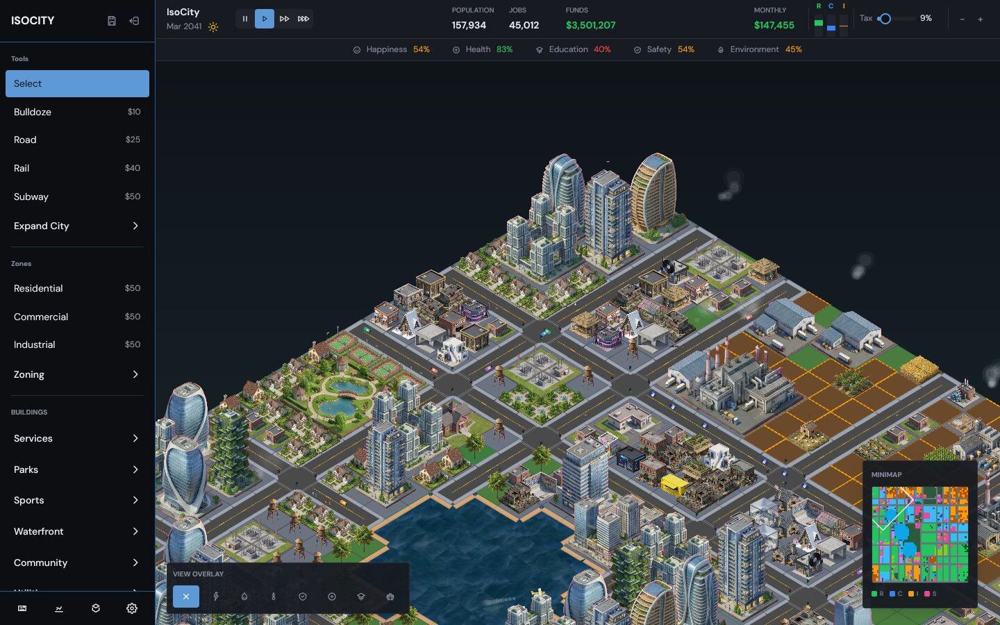
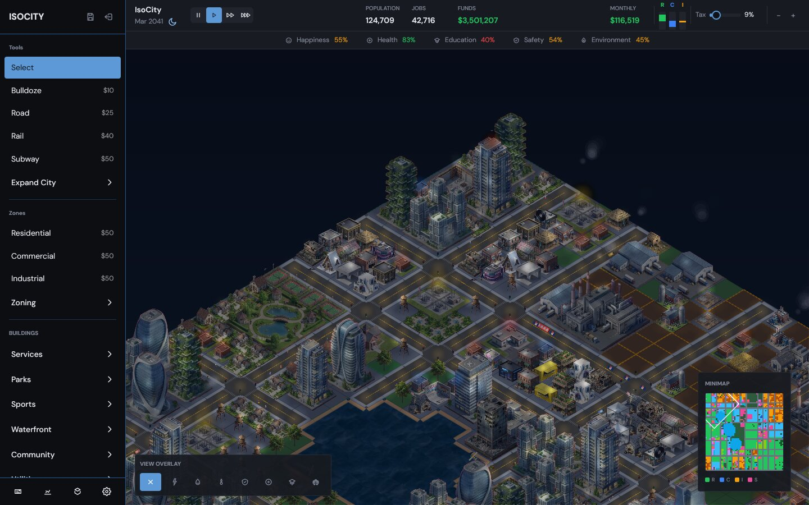

# city-builder

A desktop isometric city builder written in Rust with [GPUI](https://www.gpui.rs/).
It ports [IsoCity](https://github.com/amilich/isometric-city) (a Next.js/Canvas web
game) to a native app. The goal is the same gameplay, simulation rules, and look
as the web version.




## Features

- **Interactive grid**: place roads, rail, subway, zones (residential, commercial,
  industrial), services, parks, sports, waterfront, community buildings and
  utilities. Roads and rail are drawn in straight lines and bridge across water.
  Zones are painted by dragging. There are also bulldoze, terraform, service
  upgrades, and expand/shrink city.
- **Economy and growth**: the city simulation is a port of the web version. It
  covers demand, taxes, budgets, power and water, service coverage, land value,
  pollution, construction, abandonment, advisors, and connecting to neighbouring
  cities for trade income.
- **Traffic**:
  - Cars keep to the right lane, queue behind each other, and stop at traffic
    lights.
  - Railroad crossings have flashing signals and gates, and road traffic waits
    while a train passes.
  - Buses run between stops. Fire trucks are dispatched from fire stations, and
    police cars patrol.
- **Trains, boats and aircraft**:
  - Freight and passenger trains run with carriages, stop at stations, and puff
    smoke.
  - Boats sail between marinas and piers, and barges come in from the map
    edge.
  - Planes take off and land at airports with contrails. Helicopters fly
    between heliports, and seaplanes use bays.
- **Pedestrians**: walkers path along sidewalks from homes to destinations,
  spend time in parks, and walk back.
- **Day/night cycle**: a darkness layer with street and window lights and
  coloured glows around service buildings. Settings has an Auto/Day/Night
  override.
- **Save and load**: multiple cities are kept on disk, autosaved every 30 s.
  The start screen offers Continue and a saved-cities list, and you can
  import/export JSON. Saves use the web version's JSON format, so cities
  exported from the browser game load here.
- **UI**:
  - Sidebar with category flyouts.
  - Top bar with date, speed, funds, RCI demand and tax.
  - Budget, statistics, advisors and settings panels.
  - Tile inspector, notifications, view overlays (power, water, fire, police,
    health, education, subway), and a minimap.
  - Default, Harry Potter and Chinese sprite packs.

Single player only for now. The architecture is ready for online play (see
below).

## Building and running

You need a stable Rust toolchain (1.85+). On Linux you also need the system
libraries GPUI uses:

```sh
# Debian/Ubuntu
sudo apt install libxkbcommon-dev libxkbcommon-x11-dev libwayland-dev \
  libvulkan1 libfontconfig-dev libssl-dev pkg-config
```

macOS needs Xcode command line tools. Windows needs the MSVC toolchain.

```sh
cargo run --release                   # start screen
cargo run --release -- --new          # jump into a fresh city
cargo run --release -- --new --seed 7 # deterministic terrain
cargo run --release -- --example 1    # load a bundled example (0-3)
cargo run --release -- --load my.city.gz
cargo test --workspace
```

Cities are saved under `$XDG_DATA_HOME/isocity/cities` (Linux),
`~/Library/Application Support/isocity/cities` (macOS) or
`%APPDATA%\isocity\cities` (Windows).

### Controls

| Input | Action |
| --- | --- |
| Drag empty ground, middle/right drag, WASD / arrows | Pan |
| Scroll, `+` / `-` | Zoom |
| Click / drag with a tool | Place, or paint zones and lines |
| `Space` | Pause / resume |
| `1` `2` `3`, `0` | Speed, pause |
| `B` / `R` | Bulldoze / road tool |
| `Esc` | Back to the select tool, close panels |

Debug environment variables: `ISOCITY_FPS=1` logs frame timings,
`ISOCITY_DAY_NIGHT=day|night` forces the lighting, and
`ISOCITY_CENTER=x,y[,zoom]` centres the camera on a tile.

## Architecture

```
crates/
  isocity-core/   pure simulation: no UI, no rendering, deterministic
  isocity-app/    GPUI desktop app (binary `isocity`)
assets/           sprite sheets, example cities, DM Sans fonts
```

**isocity-core** holds the game state (`GameState`, which serializes to the web
version's JSON), terrain generation, the monthly/tick simulation (`sim`),
placement rules (`place`), and save files (`save`).
- Randomness comes from a seeded `Rng` stored inside the state, so the same
  state and the same commands always produce the same city.
- All player actions are `Command` values applied by `command::apply`.

**isocity-app** renders the city and runs the client-side animation:
- `render/`: static ground (terrain, water, beaches, roads, rail, bridges) is
  drawn with tiny-skia, a Canvas2D-like port of the web drawing code. It is
  baked into chunk textures at several zoom levels on background threads and
  re-baked only for regions that change.
  - Building sprites are cut from the original sprite sheets. Their red
    background is keyed out at load time.
  - Placement math follows the web version, so cities look the same in both.
  - `lighting.rs` renders the night layer.
- `entities/`: cars, buses, emergency vehicles, pedestrians, trains, crossings,
  aircraft, boats, smoke. As in the web version, these are visual only and
  are not part of the simulation state.
- `ui/`: start screen, game view (sidebar, top bar, map canvas, minimap), and
  panels.

### Extending to online play

The UI never mutates `GameState` directly. It goes through the `Session` trait
(`isocity-core/src/session.rs`):

```rust
pub trait Session {
    fn state(&self) -> &GameState;
    fn submit(&mut self, cmd: Command) -> CommandResult;
    fn advance(&mut self, dt: f32) -> u32; // runs simulation ticks
    ...
}
```

`LocalSession` applies commands immediately and records each one as a
`SequencedCommand` (sequence number plus tick) in an outbox. A networked
session can implement the same trait in either of two ways:

1. **Lockstep**: send commands to a relay and apply the agreed, ordered stream
   at the stamped ticks. The simulation is deterministic, so each peer only
   exchanges commands, never the whole state.
2. **Authoritative server**: forward commands to the server and replace the
   local state with its snapshots. `GameState` is already serde-serializable
   and compresses well with gzip.

Commands and states are plain serde types, so either transport needs no
changes to the game or UI code.

## Credits

The game design, simulation rules, sprite artwork and example cities come from
[IsoCity](https://github.com/amilich/isometric-city) by amilich, used
under the MIT license (see `assets/LICENSE-isocity-assets.txt`). The DM Sans
font is under the SIL Open Font License (`assets/fonts/OFL.txt`).
